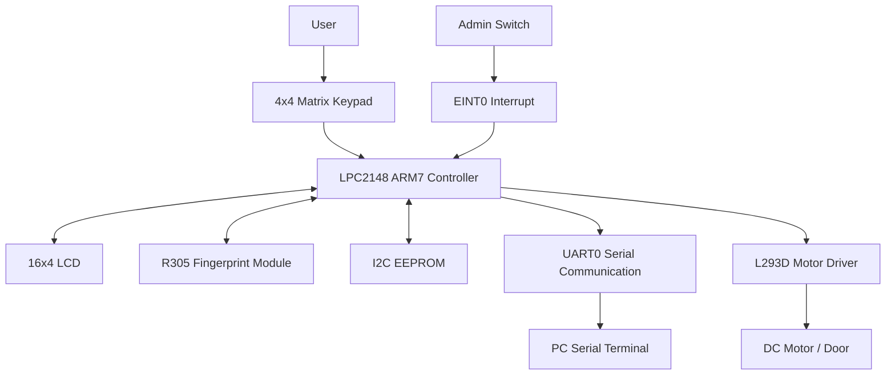
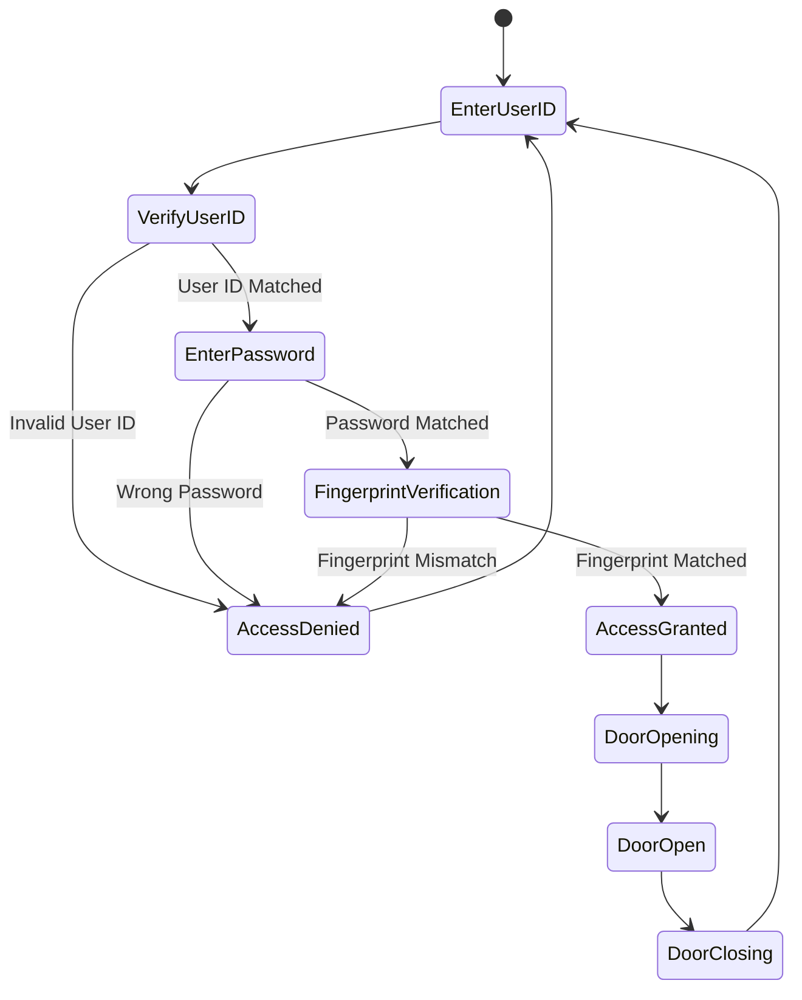

# SecureGate Pro
### LPC2148-Based Multi-Level Authentication and Door Access Control System

## Project Overview

**SecureGate Pro** is an embedded security and access-control system developed using the **NXP LPC2148 ARM7 microcontroller** and Embedded C.

The system provides three-level user authentication using:

1. User ID verification
2. Password verification
3. Fingerprint authentication using the R305 fingerprint module

The door opens only when all three authentication stages are successful. An administrator interface is also provided to manage users, passwords, fingerprints, and the stored user database.

The firmware is developed using register-level programming in Embedded C.

---

## Key Features

- Three-level authentication (User ID, Password, Fingerprint).
- R305 fingerprint module integration through UART1.
- External I2C EEPROM for persistent user data storage.
- Administrator authentication and management menu.
- Add and delete registered users.
- Update user passwords.
- Update registered fingerprints.
- Change administrator password.
- Clear user database and fingerprint templates.
- 16x4 LCD for displaying system information.
- 4x4 matrix keypad for user interaction.
- L293D motor driver for door opening and closing.
- UART0 serial communication for system messages and debugging.
- External interrupt (EINT0) for administrator menu access.

---

## Hardware Components

| Component | Description |
|---|---|
| LPC2148 | ARM7-based main microcontroller |
| 16x4 LCD | Displays authentication and system status |
| 4x4 Matrix Keypad | User input and menu navigation |
| R305 Fingerprint Module | Fingerprint enrolment and identification |
| I2C EEPROM | Stores user credentials and administrator password |
| L293D Motor Driver | Controls DC motor direction |
| DC Motor | Door opening and closing mechanism |
| MAX232 / Serial Interface | UART0 communication with PC terminal |
| External Switch | Administrator menu request through EINT0 |

---

## Communication Protocols

| Protocol | Connected Module | Purpose |
|---|---|---|
| UART0 | PC Serial Terminal | Debugging and system messages |
| UART1 | R305 Fingerprint Sensor | Fingerprint communication |
| I2C | External EEPROM | User database storage |
| GPIO | LCD | Display control and data |
| GPIO | Matrix Keypad | Key scanning |
| GPIO | L293D | Motor control |
| EINT0 | External Switch | Administrator menu request |

---

## System Architecture



---

## Authentication Workflow

The system verifies the user through three authentication stages before granting access.

### Authentication State Machine



**Access is granted only after successful verification of the User ID, password, and fingerprint.**

### Authentication Process

1. User enters a four-digit User ID through the keypad.
2. The system searches the EEPROM database.
3. If the User ID exists, the system requests the password.
4. The entered password is compared with the stored password.
5. If the password matches, the system requests fingerprint authentication.
6. The R305 module identifies the fingerprint.
7. The identified fingerprint ID is compared with the fingerprint ID associated with the user.
8. If all three stages are successful, access is granted.
9. The motor driver opens the door for the configured duration and then closes it.

---

## Administrator Menu

The administrator menu is accessed through an external interrupt switch connected to EINT0.

After entering the correct administrator password, the administrator can access the following options.

| Option | Function |
|---|---|
| 1 | Update User Password |
| 2 | Update User Fingerprint |
| 3 | Add New User |
| 4 | Delete Existing User |
| 5 | Clear Database |
| 6 | Change Administrator Password |
| 7 | Exit Administrator Menu |

### User Registration Process

1. Enter a new four-digit User ID.
2. Check whether the User ID already exists.
3. Allocate an available fingerprint ID.
4. Enter and confirm a four-digit password.
5. Enrol the fingerprint using the R305 module.
6. Store the user information in external EEPROM.

### Password Update Process

1. Enter the existing User ID.
2. Verify the current password.
3. Enter the new password.
4. Confirm the new password.
5. Update the password in EEPROM if both entries match.

### Fingerprint Update Process

1. Enter the existing User ID.
2. Verify the user's current password.
3. Delete the previously registered fingerprint.
4. Enrol a new fingerprint using the same allocated fingerprint ID.

### Database Reset

- Clears the stored user records in EEPROM.
- Deletes all fingerprint templates from the R305 module.
- Resets the administrator password to the default password `1234`.

---

## LPC2148 Pin Configuration

The following pin assignments are based on the project source code.

| LPC2148 Pin | Peripheral | Function |
|---|---|---|
| P0.0 | UART0 | TXD0 |
| P0.1 | UART0 | RXD0 |
| P0.2 | I2C | SCL |
| P0.3 | I2C | SDA |
| P0.4 | L293D | Motor IN1 |
| P0.5 | L293D | Motor IN2 |
| P0.7 | L293D | Motor Enable |
| P0.8 | UART1 | TXD1 |
| P0.9 | UART1 | RXD1 |
| P0.12 | LCD | RS |
| P0.13 | LCD | EN |
| P0.16 | EINT0 | Administrator Switch |
| P1.16–P1.19 | Keypad | Row Lines |
| P1.20–P1.23 | Keypad | Column Lines |
| P1.24–P1.31 | LCD | Data Lines D0–D7 |

---

## EEPROM Database Organisation

The external I2C EEPROM stores administrator credentials and user records.

| Parameter | Configuration |
|---|---|
| I2C Slave Address | `0x50` |
| Administrator Password Address | `0–3` |
| User Database Starting Address | `10` |
| Maximum User Records | 9 |
| Record Size | 10 Bytes |

### User Record Structure

Each user record contains:

| Field | Data Type | Size |
|---|---|---|
| User ID | `u32` | 4 Bytes |
| Password | `u32` | 4 Bytes |
| Fingerprint ID | `u8` | 1 Byte |
| Record Status | `u8` | 1 Byte |

The database supports active and deleted record identification using status values.

---

## Firmware Modules

The project firmware is organised into separate source and header files for modular development.

| Module | Responsibility |
|---|---|
| `main.c` | Main application logic and authentication workflow |
| `main_defines.c/.h` | User ID and password input handling |
| `lcd.c/.h` | LCD initialization and display operations |
| `lcd_defines.h` | LCD command and pin definitions |
| `keypad.c/.h` | Matrix keypad scanning |
| `keypad_defines.h` | Keypad pin definitions |
| `uart.c/.h` | UART0 and UART1 communication |
| `uart_defines.h` | UART configuration definitions |
| `fingerprint.c/.h` | R305 fingerprint commands and operations |
| `database.c/.h` | User database and administrator password management |
| `i2c.c/.h` | I2C peripheral communication |
| `i2c_defines.h` | I2C configuration definitions |
| `i2c_eeprom.c/.h` | EEPROM read and write operations |
| `i2c_eeprom_defines.h` | EEPROM-related definitions |
| `motor.c/.h` | Door motor control |
| `interrupt.c/.h` | EINT0 interrupt configuration |
| `rtc.c/.h` | RTC initialization |
| `delay.c/.h` | Software delay functions |
| `types.h` | Common data type definitions |
| `log.c/.h` | Serial logging support |

---

## UART Serial Output

UART0 is configured for serial communication with the PC terminal.

**UART0 Configuration:**

- Baud Rate: 9600
- Data Bits: 8
- Parity: None
- Stop Bits: 1
- Communication: UART0

### Example System Messages

```text
*****WELCOME TO*****
***SECUREGATE PRO***

USER ID:MATCHED
PASSWORD:MATCHED
FINGER:MATCHED
ACCESS GRANTED
DOOR OPENING
DOOR CLOSING
```

### Test Output Logs

The development archive contains the following UART output log files:

- `log1.TXT`
- `log2.TXT`
- `log3.TXT`

These logs document testing of authentication and administrator operations, including successful access, invalid credentials, fingerprint verification, user management, and database reset.

---

## Door Control Mechanism

The L293D motor driver controls the DC motor used for door movement.

| Operation | Motor Direction | Configured Duration |
|---|---|---|
| Door Opening | Forward | 3000 ms |
| Door Hold | 2000 ms | Configured delay |
| Door Closing | Reverse | 3000 ms |

The current firmware uses time-based motor control. The door limit-switch option is disabled in the current motor configuration.

---

## Development Environment

| Tool / Technology | Purpose |
|---|---|
| Embedded C | Firmware development |
| Keil µVision | Code development and compilation |
| LPC2148 ARM7 | Target microcontroller |
| Proteus | Circuit simulation |
| UART Terminal | Serial output monitoring |
| I2C | EEPROM communication |
| UART | Fingerprint module communication |

---

## Build and Programming

1. Open the project in Keil µVision.
2. Select the LPC2148 target microcontroller.
3. Add the required `.c` source files to the project.
4. Ensure the corresponding `.h` header files are accessible.
5. Configure the target clock and linker settings.
6. Compile and build the firmware.
7. Generate the HEX firmware image.
8. Flash the firmware onto the LPC2148 using a compatible programming tool.
9. Connect UART0 to a serial terminal configured for 9600 baud, 8N1.

---

## Repository Contents

This GitHub repository contains only the Embedded C source and header files, along with this README documentation.

- `.c` – Embedded C source files
- `.h` – Header files

### Development and Testing Artifacts

The following files are referenced for documentation purposes but are not included in the GitHub repository:

- `securegate_pro.hex` – Generated firmware image.
- `log1.TXT` – UART output log.
- `log2.TXT` – UART output log.
- `log3.TXT` – UART output log.

---

## Project Summary

**SecureGate Pro** demonstrates the practical implementation of embedded systems concepts through a multi-level authentication and automated door access-control application.

The project involves:

- ARM7 LPC2148 microcontroller programming.
- Register-level Embedded C development.
- UART communication and fingerprint sensor integration.
- I2C EEPROM interfacing and database management.
- LCD and matrix keypad interfacing.
- External interrupt handling.
- DC motor control using L293D.
- Modular firmware development and debugging.

---

**Project Name:** SecureGate Pro  
**Microcontroller:** NXP LPC2148 (ARM7)  
**Programming Language:** Embedded C  
**Development Environment:** Keil µVision  
**Application:** Multi-Level Authentication and Door Access Control System
