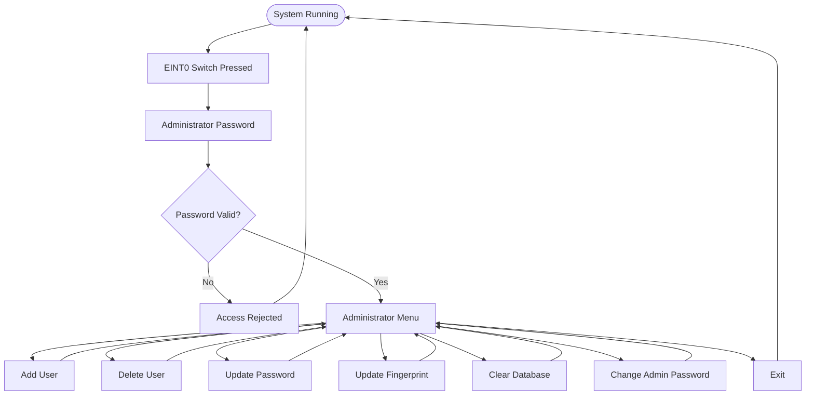

# SecureGate Pro
### LPC2148-Based Multi-Level Authentication and Door Access Control System

## Overview

**SecureGate Pro** is an embedded security and access-control system developed using the **LPC2148 ARM7 microcontroller** and register-level Embedded C programming.

The system provides three-level user authentication using:

1. User ID verification
2. Password verification
3. Fingerprint verification

The door is unlocked only when all three authentication stages are successful.

The system also provides an administrator interface for managing registered users, passwords, fingerprints, and the user database. An LCD displays system information, while UART0 provides real-time serial messages for monitoring and debugging.

---

## Key Features

- Three-level user authentication (User ID, Password, Fingerprint).
- Fingerprint authentication using the R305 fingerprint module.
- Secure user record storage using external I2C EEPROM.
- Administrator authentication and protected menu.
- Add and delete registered users.
- Update user passwords.
- Update registered fingerprints.
- Change administrator password.
- Clear the user database.
- Automatic fingerprint ID allocation.
- LCD-based user interaction and system status display.
- UART-based debugging and event monitoring.
- Interrupt-based administrator menu access.
- DC motor-based door opening and closing using L293D.

---

## Hardware Components

| Component | Description |
|---|---|
| LPC2148 | ARM7 main microcontroller |
| 16x4 LCD | User interface and status display |
| 4x4 Matrix Keypad | User input and menu navigation |
| R305 Fingerprint Module | Fingerprint enrolment and verification |
| I2C EEPROM | Persistent user and administrator data storage |
| MAX232 / Serial Interface | UART communication with PC |
| L293D | DC motor driver |
| DC Motor | Door opening and closing mechanism |
| External Switch | Administrator menu request through EINT0 |

---

## Communication Protocols

| Protocol | Application |
|---|---|
| UART0 | Serial monitoring and debugging |
| UART1 | R305 fingerprint module communication |
| I2C | External EEPROM communication |
| GPIO | LCD, keypad and motor control |
| EINT0 | External interrupt for administrator menu request |

---

## System Architecture

The following block diagram illustrates the overall hardware and firmware interaction.

flowchart TB
    U["USER"] --> K["4x4 MATRIX KEYPAD"]
    A["ADMIN SWITCH"] --> E["EINT0 INTERRUPT"]

    K --> MCU["LPC2148 ARM7<br/>MAIN CONTROLLER"]
    E --> MCU

    MCU <--> LCD["16x4 LCD"]
    MCU <--> FP["R305 FINGERPRINT<br/>UART1"]
    MCU <--> EE["I2C EEPROM"]
    MCU --> LOG["UART0 SERIAL LOG"]
    LOG --> PC["PC TERMINAL"]
    MCU --> MD["L293D MOTOR DRIVER"]
    MD --> MOTOR["DC DOOR MOTOR"]

    classDef input fill:#dbeafe,stroke:#2563eb,color:#172554,stroke-width:2px
    classDef controller fill:#d1fae5,stroke:#059669,color:#064e3b,stroke-width:3px
    classDef peripheral fill:#fef3c7,stroke:#d97706,color:#78350f,stroke-width:2px
    classDef output fill:#fce7f3,stroke:#db2777,color:#831843,stroke-width:2px

    class U,A,K,E input
    class MCU controller
    class LCD,FP,EE,LOG,MD peripheral
    class PC,MOTOR output

---

## User Authentication Flow

The system verifies the user's credentials in three stages before granting access.

flowchart TD
    A([SYSTEM READY]) --> B["Enter User ID"]
    B --> C{"User ID Valid?"}

    C -->|No| X["ACCESS DENIED"]
    C -->|Yes| D["Enter Password"]

    D --> E{"Password Valid?"}
    E -->|No| X
    E -->|Yes| F["Fingerprint Verification"]

    F --> G{"Fingerprint Match?"}
    G -->|No| X
    G -->|Yes| H["ACCESS GRANTED"]

    H --> I["Door Opening"]
    I --> J["Door Hold"]
    J --> K["Door Closing"]

    K --> B
    X --> B

    classDef process fill:#dbeafe,stroke:#2563eb,color:#172554,stroke-width:2px
    classDef decision fill:#fef3c7,stroke:#d97706,color:#78350f,stroke-width:2px
    classDef success fill:#d1fae5,stroke:#059669,color:#064e3b,stroke-width:2px
    classDef failure fill:#fee2e2,stroke:#dc2626,color:#7f1d1d,stroke-width:2px

    class B,D,F,I,J,K process
    class C,E,G decision
    class H success
    class X failure

---

## Administrator Module

The administrator menu is accessed through the external interrupt switch connected to EINT0.

The administrator must enter the correct administrator password before accessing the management functions.

### Administrator Menu Options

| Option | Function |
|---|---|
| 1 | Update User Password |
| 2 | Update User Fingerprint |
| 3 | Add New User |
| 4 | Delete Existing User |
| 5 | Clear User Database |
| 6 | Change Administrator Password |
| 7 | Exit Administrator Menu |

### User Registration Process

1. Enter a new User ID.
2. Check whether the User ID already exists.
3. Allocate an available fingerprint ID.
4. Enter the password.
5. Re-enter the password for confirmation.
6. Enrol the fingerprint using the R305 module.
7. Store the user record in external EEPROM after successful enrolment.

### User Fingerprint Update

1. Enter the existing User ID.
2. Verify the current user password.
3. Delete the previously registered fingerprint.
4. Enrol the new fingerprint using the allocated fingerprint ID.

### User Deletion

1. Enter the registered User ID.
2. Search for the user record.
3. Delete the corresponding fingerprint template.
4. Update the user record status in EEPROM.

---

## Administrator Workflow



---

## Firmware Architecture

The firmware is developed using Embedded C with register-level peripheral programming.

The source code is organised into separate modules for better readability, debugging, and maintenance.

| Module | Responsibility |
|---|---|
| `main.c` | Main application logic, authentication and administrator menu |
| `main_defines.c / .h` | User ID and password input handling |
| `lcd.c / .h` | LCD initialization and display functions |
| `lcd_defines.h` | LCD configuration definitions |
| `keypad.c / .h` | Matrix keypad scanning |
| `keypad_defines.h` | Keypad pin definitions |
| `uart.c / .h` | UART0 and UART1 communication |
| `uart_defines.h` | UART configuration |
| `fingerprint.c / .h` | R305 fingerprint communication and operations |
| `database.c / .h` | User records and administrator password management |
| `i2c.c / .h` | LPC2148 I2C peripheral communication |
| `i2c_defines.h` | I2C configuration definitions |
| `i2c_eeprom.c / .h` | EEPROM read and write operations |
| `i2c_eeprom_defines.h` | EEPROM slave address definitions |
| `motor.c / .h` | Door motor control |
| `interrupt.c / .h` | EINT0 interrupt configuration |
| `rtc.c / .h` | RTC initialization |
| `delay.c / .h` | Software delay functions |
| `log.c / .h` | UART0 logging support |
| `types.h` | Common project data type definitions |

---

## LPC2148 Pin Configuration

| LPC2148 Pin | Peripheral | Function |
|---|---|---|
| P0.0 | UART0 | TX |
| P0.1 | UART0 | RX |
| P0.2 | I2C | SCL |
| P0.3 | I2C | SDA |
| P0.4 | L293D | Motor IN1 |
| P0.5 | L293D | Motor IN2 |
| P0.7 | L293D | Motor Enable |
| P0.8 | UART1 | TX |
| P0.9 | UART1 | RX |
| P0.12 | LCD | RS |
| P0.13 | LCD | EN |
| P0.16 | EINT0 | Administrator Switch |
| P1.16-P1.19 | Keypad | Row Pins |
| P1.20-P1.23 | Keypad | Column Pins |
| P1.24-P1.31 | LCD | Data Bus D0-D7 |

---

## EEPROM Data Management

External I2C EEPROM is used for storing user records and administrator password information.

### EEPROM Configuration

| Parameter | Value |
|---|---|
| Communication | I2C |
| Slave Address | 0x50 |
| Administrator Password Address | 0 |
| User Records Starting Address | 10 |
| Maximum User Records | 9 |
| Record Size | 10 Bytes |

### User Record Structure

Each user record contains:

- User ID
- User Password
- Fingerprint ID
- Record Status

The database module provides functions for adding, searching, updating, deleting, and clearing user records.

---

## Door Control Mechanism

The L293D motor driver controls the DC motor used for door movement.

The motor operates in two directions:

- Forward direction: Door opening.
- Reverse direction: Door closing.

### Door Operation Sequence

| Operation | Duration |
|---|---|
| Door Opening | 3000 ms |
| Door Hold | 2000 ms |
| Door Closing | 3000 ms |

**Note:** The current firmware uses time-based motor control. The door limit-switch input is disabled in the current configuration.

---

## UART Monitoring and Debugging

UART0 is used to transmit system messages to a PC serial terminal.

### UART0 Configuration

| Parameter | Value |
|---|---|
| Baud Rate | 9600 |
| Data Bits | 8 |
| Parity | None |
| Stop Bits | 1 |

### Sample Serial Messages

```text
====================
*****WELCOME TO*****
***SECUREGATE PRO***
====================

ID FOUND
PASSWORD MATCHED
ACCESS GRANTED

DOOR OPENING
DOOR CLOSING

ACCESS DENIED
USER ADDED SUCCESSFULLY
USER DELETED
UPDATED SUCCESSFULLY
```

### Test Output Logs

The development archive contains the following serial output log files:

- `log1.TXT`
- `log2.TXT`
- `log3.TXT`

These logs document testing of authentication, user management, fingerprint operations, and database functions.

---

## Development Environment

| Tool | Purpose |
|---|---|
| Keil µVision | Embedded C development and compilation |
| Proteus | Circuit simulation and hardware testing |
| LPC2148 | Target microcontroller |
| Serial Terminal | UART communication and debugging |
| Embedded C | Firmware development |

---

## Build and Programming

1. Open the project in Keil µVision.
2. Select the LPC2148 microcontroller.
3. Add the required `.c` source files to the project.
4. Include the corresponding `.h` header files.
5. Configure the target clock and project settings.
6. Compile and build the firmware.
7. Resolve any compilation or linker errors.
8. Generate the HEX firmware file.
9. Flash the generated firmware into the LPC2148.
10. Connect the UART0 serial interface to monitor system messages.

The generated firmware image in the development archive is:

`securegate_pro.hex`

---

## Repository Contents

This GitHub repository contains the Embedded C source code and header files required to understand and develop the SecureGate Pro firmware.

### File Types

- `.c` – Embedded C source files
- `.h` – Header files
- `README.md` – Project documentation

### Development and Testing Artifacts

The following files are mentioned for reference but are not included in this source-only GitHub repository:

- `securegate_pro.hex` – Compiled firmware output
- `log1.TXT` – Serial output log
- `log2.TXT` – Serial output log
- `log3.TXT` – Serial output log

---

## Project Highlights

- Developed bare-metal Embedded C firmware for the LPC2148 ARM7 microcontroller.
- Implemented UART communication with the R305 fingerprint module.
- Integrated I2C EEPROM for persistent user data storage.
- Developed a multi-level authentication mechanism.
- Implemented an administrator interface for user and database management.
- Integrated LCD, keypad, external interrupt, and DC motor control.
- Used modular programming for peripheral interfacing and application development.
- Implemented UART-based debugging and system monitoring.

---

## Project Information

| Category | Details |
|---|---|
| Project Name | SecureGate Pro |
| Controller | LPC2148 |
| Architecture | ARM7 |
| Programming Language | Embedded C |
| Programming Approach | Register-Level / Bare-Metal |
| Fingerprint Module | R305 |
| Communication | UART, I2C, GPIO |
| Development IDE | Keil µVision |
| Simulation | Proteus |

---

**SecureGate Pro – Embedded Access Control System**

*Designed and developed using LPC2148 ARM7 and Embedded C.*
