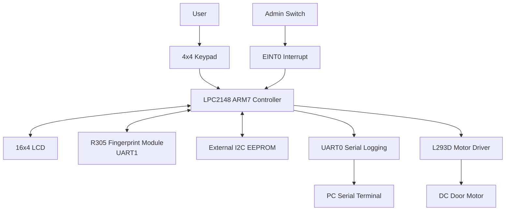
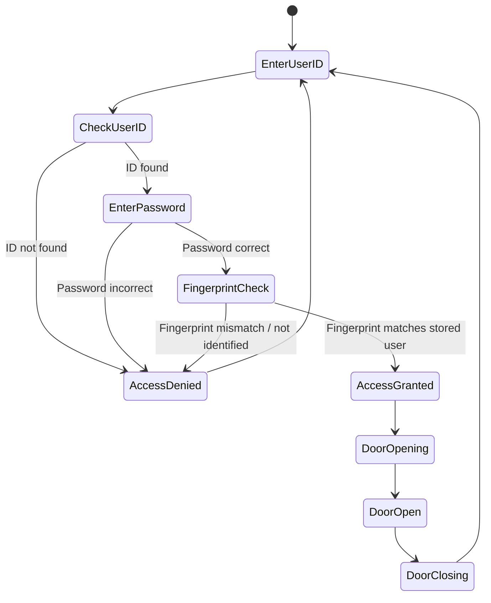

# SecureGate Pro
### LPC2148-Based Multi-Level Authentication and Door Access Control System

SecureGate Pro is an embedded access-control system developed using the **NXP LPC2148 ARM7 microcontroller** and register-level Embedded C. It verifies a user's identity through three authentication stages—**User ID, password, and fingerprint**—before allowing the door to open.

The firmware also provides an administrator menu for managing users, fingerprints, passwords, and the stored user database. UART0 is used to send system and access-event messages to a serial terminal.

---

## Key Features

- **Three-level user authentication:** User ID → password → fingerprint.
- **Fingerprint verification:** R305 fingerprint module connected through UART1.
- **Persistent user records:** User ID, password, fingerprint ID, and record status are stored in external I²C EEPROM.
- **Administrator menu:** Protected menu for user and system management.
- **User management:** Add users, delete users, and update an existing user's password or fingerprint.
- **Administrator password management:** Change the administrator password.
- **Database reset:** Clear stored user records and reset the administrator password to the default value.
- **Door control:** L293D motor-driver interface controls the DC motor for timed door opening and closing.
- **LCD interface:** Displays prompts, authentication status, menu options, and door status.
- **Serial event logging:** UART0 sends readable system messages to a serial terminal.
- **Interrupt-based menu request:** External interrupt EINT0 sets the flag that requests the administrator menu.

## Hardware and Interfaces

| Component | Purpose | Interface |
|---|---|---|
| LPC2148 | Main controller | ARM7 |
| 16×4 LCD | User prompts and system status | 8-bit GPIO |
| 4×4 matrix keypad | User input and menu navigation | GPIO |
| R305 fingerprint module | Fingerprint enrolment and identification | UART1 |
| I²C EEPROM | User records and administrator password storage | I²C |
| MAX232 / serial interface | Serial output to PC terminal | UART0 |
| L293D | DC motor direction control | GPIO |
| DC motor | Door movement | Motor driver |
| Admin switch | Requests administrator menu | EINT0 |

## System Architecture

## Authentication State Machine

The normal user-access sequence is:

**Access is granted only when all three checks succeed.** A failed ID, password, or fingerprint check results in access denial.

## Administrator Menu

The administrator menu is requested using the external interrupt switch. The administrator must enter the correct administrator password before accessing the menu.

| Key | Function |
|---|---|
| 1 | Update a user's password |
| 2 | Update a user's fingerprint |
| 3 | Add a new user |
| 4 | Delete a user |
| 5 | Clear the user database |
| 6 | Change administrator password |
| 7 | Exit administrator menu |

### User enrolment sequence

1. Enter the new four-digit user ID.
2. Check that the user ID is not already registered.
3. Allocate an available fingerprint ID.
4. Enter and confirm the user's four-digit password.
5. Enrol the fingerprint using the R305 module.
6. Save the user record in EEPROM after successful fingerprint enrolment.

### Fingerprint update sequence

1. Enter the existing user ID.
2. Verify the user's current password.
3. Delete the old fingerprint template.
4. Enrol the replacement fingerprint using the allocated fingerprint ID.

## Firmware Modules

The repository is intended to contain the project **`.c` and `.h` source files**. The main responsibilities of the source modules are listed below.

| Source module | Responsibility |
|---|---|
| `main.c` | System initialization, main application loop, user authentication, administrator menu, and access control |
| `main_defines.c` / `main_defines.h` | Keypad-based entry of user IDs and passwords, backspace, and input handling |
| `lcd.c` / `lcd.h` / `lcd_defines.h` | LCD initialization, command/data writing, and number/string display |
| `keypad.c` / `keypad.h` / `keypad_defines.h` | 4×4 matrix keypad initialization and key scanning |
| `uart.c` / `uart.h` / `uart_defines.h` | UART0 and UART1 initialization and transmit/receive routines |
| `fingerprint.c` / `fingerprint.h` | R305 command packets, fingerprint enrolment, deletion, and identification |
| `database.c` / `database.h` | User-record management, password updates, fingerprint-ID allocation, and administrator-password handling |
| `i2c.c` / `i2c.h` / `i2c_defines.h` | LPC2148 I²C peripheral initialization and communication routines |
| `i2c_eeprom.c` / `i2c_eeprom.h` / `i2c_eeprom_defines.h` | EEPROM byte write and random read operations |
| `motor.c` / `motor.h` | Motor-driver initialization and timed door open/close control |
| `interrupt.c` / `interrupt.h` | EINT0 interrupt configuration and administrator-menu request flag |
| `rtc.c` / `rtc.h` | RTC peripheral initialization |
| `delay.c` / `delay.h` | Software delay routines |
| `types.h` | Common fixed-width project data-type definitions |
| `log.c` / `log.h` | UART0 serial logging support module |

## Pin Configuration

The following pin assignments are defined in the supplied source files.

| LPC2148 pin | Connected module / signal |
|---|---|
| P0.0 / P0.1 | UART0 TX / RX |
| P0.2 / P0.3 | I²C SCL / SDA |
| P0.4 / P0.5 | L293D motor direction inputs |
| P0.7 | L293D enable |
| P0.8 / P0.9 | UART1 TX / RX (R305) |
| P0.12 / P0.13 | LCD RS / EN |
| P0.16 | EINT0 administrator-menu switch input |
| P1.16–P1.19 | Keypad rows |
| P1.20–P1.23 | Keypad columns |
| P1.24–P1.31 | LCD data bus D0–D7 |

**Note:** The door-switch input is disabled in the current `motor.h` configuration (`DOOR_SWITCH_ENABLED 0`). Door closing therefore uses the configured timed reverse-motor operation rather than limit-switch feedback.

## EEPROM Data Management

The firmware uses the I²C EEPROM at **7-bit slave address `0x50`**.

- Administrator password storage begins at EEPROM address `0`.
- User records begin at EEPROM address `10`.
- Maximum user records: **9**.
- Record size: **10 bytes**.
- Each user record stores the user ID, password, fingerprint ID, and record status.
- Active and deleted records are distinguished using record-status values.

## Serial Output and Test Logs

UART0 is configured for **9600 baud, 8 data bits, no parity, and 1 stop bit (8N1)**. The firmware sends messages such as:

- `USER ID:MATCHED`
- `PASSWORD:MATCHED`
- `FINGER:MATCHED`
- `ACCESS GRANTED`
- `ACCESS DENIED`
- `DOOR OPENING`
- `DOOR CLOSING`
- `USER ADDED SUCCESSFULLY`
- `USER DELETED`
- `PASSWORD UPDATED`

The project archive used during development contains the following serial output log files:

- `log1.TXT`
- `log2.TXT`
- `log3.TXT`

These logs show test runs covering successful access, invalid user IDs, incorrect passwords, fingerprint mismatch, user addition/deletion, password updates, and database clearing.

## Build and Programming

1. Open the project source in **Keil µVision** with the LPC2148 device support installed.
2. Add the required `.c` source modules to the project and ensure the corresponding header files are available to the compiler.
3. Select the appropriate LPC2148 target and review the target clock and linker settings.
4. Build the firmware and resolve any compiler or linker errors.
5. Program the generated firmware onto the LPC2148 using a compatible flash-programming tool.
6. Connect the serial terminal to UART0 using the configured **9600 baud, 8N1** settings to observe system messages.

The generated firmware image is named **`securegate_pro.hex`** in the supplied development archive. It is a build output and is not part of the source-only GitHub upload described for this repository.

## Repository Contents

This GitHub repository is intended to include:

- Embedded C source files (`.c`)
- Header files (`.h`)
- This `README.md`

The HEX firmware image (`securegate_pro.hex`) and serial output logs (`log1.TXT`, `log2.TXT`, and `log3.TXT`) are referenced here as development/test artifacts; they are **not included** in the source-only repository upload.

## Project Notes

- The firmware is written in Embedded C for the LPC2148.
- Peripheral access is implemented using LPC2148 register-level programming.
- The R305 fingerprint module communicates over UART1.
- User credentials and fingerprint references are maintained in external I²C EEPROM and the fingerprint module, respectively.
- The motor control in the current source is time-based; a door limit switch is not enabled.

---

**Project:** SecureGate Pro  
**Controller:** NXP LPC2148 (ARM7)  
**Firmware language:** Embedded C  
**Development environment:** Keil µVision  
